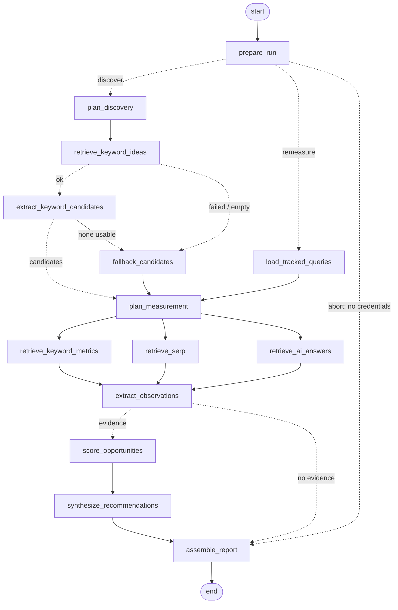

# AI Visibility Platform

*By Moiz Hassan*

A full-stack product that measures how visible a brand is in **AI answers** (ChatGPT, Google AI Overviews) and **Google search**, ranks where the opportunity is largest, and recommends specific content to close each gap. A marketer can track several brands, re-measure later, and see what changed.

- **Backend:** Flask, LangGraph multi-agent DAG, OpenAI or Anthropic tool calling, live DataForSEO data, SQLite with history ([backend/](backend/)).
- **Frontend:** Angular 21 (strict TypeScript, standalone components, signals + RxJS), served by nginx ([frontend/](frontend/), built by Codex CLI; see its [README](frontend/README.md)).
- **API contract:** [docs/api-contract.md](docs/api-contract.md) is the single source of truth both halves were built against. Integration notes between the two halves are in [docs/integration-notes.md](docs/integration-notes.md).

> **Data modes.** `live` (the default) calls the real DataForSEO API. A provider failure is shown as a failure and never replaced with invented data. `sandbox` is an **explicit opt-in** (`DATAFORSEO_MODE=sandbox`, or the `compose.sandbox.yaml` overlay). It serves *synthetic* data in DataForSEO's documented response shapes and is labelled everywhere: `data_mode: "sandbox"` on runs, reports, health and config, a `[SANDBOX DATA]` headline, and `[SANDBOX]` answer text. Mocked providers exist only inside `backend/tests/`.
>
> **Which mode was verified (§3.4 asks for this to be stated):** live DataForSEO access was **blocked by the provider**. The account returns `40104 "Please verify your account"` on every endpoint, including DataForSEO's own sandbox, and verification needs a $5 top-up that was not authorised. The live integration is fully implemented and its failure path was run against the real API. The end-to-end product run with a **real LLM** (OpenAI `gpt-4.1-mini`, real tool calling) used **sandbox** data. See the [verification log](#verification-log).

---

## Contents

1. [Quick start](#quick-start)
2. [Architecture](#architecture)
3. [The agent DAG](#the-agent-dag)
4. [Tool calling and validation](#tool-calling-and-validation) · [LLM cost governance](#llm-cost-governance)
5. [DataForSEO integration and cost control](#dataforseo-integration-and-cost-control)
6. [Opportunity scoring](#opportunity-scoring)
7. [Failure handling](#failure-handling-and-retries)
8. [Slow work and history](#slow-work-and-history)
9. [Observability and debugging a failed run](#observability-and-debugging-a-failed-run)
10. [API overview](#api-overview)
11. [Data model](#data-model)
12. [Tests](#tests)
13. [Verification log](#verification-log)
14. [Trade-offs, limitations and next steps](#trade-offs-known-limitations-and-next-steps)
15. [AI assistant usage](#ai-assistant-usage)

---

## Quick start

**Prerequisites:** Docker Desktop (Compose v2.24+), a DataForSEO account (**verified** in the DataForSEO panel, with credit), and an OpenAI *or* Anthropic API key.

```bash
cp backend/.env.example backend/.env      # then fill in DATAFORSEO_LOGIN, DATAFORSEO_PASSWORD and OPENAI_API_KEY (or ANTHROPIC_API_KEY)
docker compose up --build
```

| What | URL |
|---|---|
| Web app | http://localhost:8080 |
| API (through the nginx proxy) | http://localhost:8080/api/health |
| API (direct, for debugging) | http://localhost:5000/api/health |

- If a host port is already in use: `BACKEND_PORT=5001 FRONTEND_PORT=8081 docker compose up --build`.
- **Sandbox (opt-in, synthetic, labelled):** `docker compose -f compose.yaml -f compose.sandbox.yaml up --build`. Use it only when a live DataForSEO account isn't available. The LLM stays real and stays subject to the quotas below.
- **LLM spend is capped server-side** (defaults: 2 calls per run, 4 calls in total across the database's lifetime, 400 output tokens per call). Raise `OPENAI_MAX_CALLS_TOTAL` in `backend/.env` for normal use. When the quota is exhausted, runs still complete with live data, and the AI steps fall back to clearly labelled rule-based output (`llm_quota_exhausted`).
- `GET /api/health` reports whether credentials are *configured* (presence only, never their values).
- SQLite lives in the named volume `backend-data`, so run history survives restarts and rebuilds. `docker compose down -v` deletes it.

**Local development without Docker** (Python 3.11+, Node 24):

```bash
cd backend && python -m venv .venv && . .venv/bin/activate   # Windows: .venv\Scripts\activate
pip install -r requirements-dev.txt
python wsgi.py                       # reads backend/.env, serves http://localhost:5000
cd ../frontend && npm ci && npm start  # http://localhost:4200, proxies /api to :5000
```

Every backend setting is an environment variable. Each one is documented in [backend/.env.example](backend/.env.example). Frontend settings are documented in [frontend/ENVIRONMENT.md](frontend/ENVIRONMENT.md).

---

## Architecture

```
Angular SPA ──/api──▶ nginx ──▶ Flask API ──▶ RunService ──(ThreadPool, 202 Accepted)──▶ LangGraph DAG
                                    │                                                     │
                                    ▼                                                     ├─▶ LLM (OpenAI / Anthropic): planning + recommendations
                                 SQLite (WAL, volume)  ◀── every node persists ───────────┼─▶ DataForSEO: Labs, SERP, AI Optimization
                                                                                          └─▶ trace events, metrics, JSON logs
```

```
backend/app/
  api/            Flask blueprints: validation, error envelope, status codes
  services/       brand CRUD, run lifecycle (idempotency, dedupe, executor), reports, comparison, serializers
  graph/          LangGraph state, node wrappers (instrumentation), routing, runner
  agents/         query_planner · retrieval · extraction · scoring · synthesis · report   (one responsibility each)
  tools/          typed tool contracts (Pydantic), validation, executable DataForSEO tools, per-run budget
  integrations/   dataforseo/ HTTP client · llm/ provider-neutral interface + OpenAI/Anthropic adapters
  resilience/     error taxonomy, retry (exponential backoff + full jitter), circuit breaker
  observability/  JSON logging with correlation context + redaction, metrics registry, run trace recorder
  repositories/   persistence helpers used by DAG nodes
  models/         SQLAlchemy models        schemas/  API + inter-agent Pydantic contracts
```

**Key decisions**

| Decision | Why |
|---|---|
| Separate **planner tool calls** from **tool execution** | The LLM chooses tools and arguments through native function calling. Execution happens later in separate retrieval nodes, after validation. A model can never trigger a paid call directly, and fetching stays separate from reasoning. |
| **Discover first, then plan with the LLM** | Discovery seeds are deterministic (the question's quoted phrases plus the brand's seeds). The single planner LLM call then picks research queries from **real** discovered queries with real search volume, not from what the LLM guesses people search. |
| **Hard LLM spend governance** | At most 2 LLM requests per run (planner + synthesis) and a persistent total quota in SQLite. No automatic retries of chargeable calls, an output-token cap, an input-size guard and a response cache. See [LLM cost governance](#llm-cost-governance). |
| **Deterministic scoring**, LLM only for wording | Rankings are reproducible and explainable. The LLM can't change scores, priorities or numbers. |
| **Deterministic summary** text | Every number in the summary comes from computed values (`generated_by: "deterministic"`), so the LLM can't invent a metric. |
| SQLite + in-process thread pool | Fits the assessment scope and runs from a clean checkout. The durability limits are documented below. |
| Official `openai` / `anthropic` SDKs with **their own retries disabled** | One retry/backoff/circuit-breaker policy covers every external dependency, with uniform trace events. |

---

## The agent DAG

Generated from the compiled LangGraph (`app.graph.builder.mermaid()`). Dotted edges are conditional routes.



The three retrieval branches run **in parallel** (same LangGraph super-step), each writing to its own state key, and `extract_observations` waits for all of them. A failing branch records its error and returns. It never cancels the others.

### Agent responsibility contracts

| Agent (nodes) | Sole responsibility | Input → output contract |
|---|---|---|
| **Query Planner** (`plan_discovery`, `plan_measurement`, `load_tracked_queries`) | Interpret the research question and decide which DataForSEO tools to call, with which arguments. Discovery seeds are rule-based by default; `plan_measurement` is the LLM tool-calling step. | `BrandContext` + question (+ `KeywordCandidate[]`) → `DiscoveryPlan` / `MeasurementPlan` made only of **validated** Pydantic tool arguments |
| **Search / Retrieval** (`retrieve_keyword_ideas`, `retrieve_keyword_metrics`, `retrieve_serp`, `retrieve_ai_answers`) | Execute validated tool calls. No parsing, no reasoning. | Plan → `RawPayload[]` (provider result **or** classified error, plus cost, cache flag and task id) |
| **Extraction / Normalization** (`extract_keyword_candidates`, `fallback_candidates`, `extract_observations`) | Turn raw payloads into validated records. Missing ≠ zero. | `RawPayload` → `KeywordCandidate[]`, `NormalizedQuery[]`, `NormalizedObservation[]` (persisted) |
| **Analysis / Synthesis** (`score_opportunities`, `synthesize_recommendations`) | Compute the explainable score, then have the LLM turn evidence into recommendations (validated, with a rule-based fallback) | Observations → `ScoredOpportunity[]` → `RecommendationOut[]` (persisted) |
| **Report** (`assemble_report`) | Assemble the final JSON report and human-readable summary from existing data. No fetching, no new analysis. | Everything above → report JSON + markdown + run headline (persisted) |

Every node runs inside one instrumentation wrapper (`graph/builder.py`). The wrapper persists node state, emits `node_started` / `node_succeeded` / `node_degraded` / `node_failed`, records duration, retry count and progress, and turns an unexpected exception into a failed node instead of a crashed run.

**Run outcomes:** `success` (every branch succeeded) · `partial_success` (a report exists, but something failed or degraded, listed in `errors[]` and per node) · `failed` (no usable visibility evidence, or the worker crashed).

---

## Tool calling and validation

One tool per logical DataForSEO call ([backend/app/tools/schemas.py](backend/app/tools/schemas.py)):

| Tool | Endpoint | Planner pass |
|---|---|---|
| `discover_keyword_ideas(seed_keywords[1-5], location_code, language_code, limit≤30)` | `POST /v3/dataforseo_labs/google/keyword_ideas/live` | discovery |
| `get_keyword_metrics(keywords[1-10], location_code, language_code)` | `POST /v3/dataforseo_labs/google/keyword_overview/live` | measurement |
| `check_google_organic_serp(keyword, location_code, language_code, depth∈{10,20})` | `POST /v3/serp/google/organic/live/advanced` | measurement |
| `check_chatgpt_answer(research_query, prompt≤500, web_search, country_iso_code?)` | `POST /v3/ai_optimization/chat_gpt/llm_responses/live` | measurement |

- Each tool's Pydantic model is the single source of truth. Its JSON Schema (`additionalProperties: false`, required fields, enums, length limits) is sent to the LLM, and the same model validates whatever comes back.
- **Two validation layers** run before any paid call ([tools/validation.py](backend/app/tools/validation.py)):
  1. **Schema checks:** unknown tool, malformed JSON string, non-object arguments, missing or extra fields, wrong types, search operators (`site:` costs 5×), and invalid combinations (`country_iso_code` without `web_search`).
  2. **Run-context checks:** the market must equal the brand's market; queries must come from the candidate list; seeds must not name the brand; AI prompts must **not mention the analysed brand** (a leading prompt would bias the measurement).
- Rejected calls never execute. Valid calls in the same response are kept, and anything missing is completed deterministically (e.g. a neutral template prompt), with a note in `report.plan.notes`. If nothing valid remains, a **documented deterministic plan** is used (the highest-volume non-branded candidates with neutral template prompts), the node is marked `degraded`, and the run ends `partial_success`. A structured **repair turn** (rejected calls are sent back to the model as error tool results with exact reasons) is implemented and tested. It's **off by default** (`LLM_REPAIR_ATTEMPTS=0`) because each repair is another paid request.
- Recommendations come back through a `submit_recommendations` tool and are validated against a strict schema with word-limited fields. They must also reference existing opportunities and only that opportunity's evidence refs, and contain **no URL that isn't in the evidence**. Any invalid or missing item gets a rule-based recommendation (`generated_by: "rule_based_fallback"`), so malformed LLM output never reaches the user. `limitations` are always computed deterministically from what was and wasn't measured, never written by the LLM.
- Prompts treat user-supplied brand text as data (wrapped in XML tags and declared non-instructional). They state the single job of each stage and the exact budget, and send only compact normalized data (≈1.6k input tokens for the planner, ≈1.2k for synthesis in the verified run).

---

## LLM cost governance

The LLM key in this project is shared with limited authorisation, so spending is controlled **server-side, before any request leaves the process** ([integrations/llm/governor.py](backend/app/integrations/llm/governor.py)):

| Rule | Setting (default) | Enforcement |
|---|---|---|
| Model | `OPENAI_MODEL=gpt-4.1-mini` | Low-cost, supports function calling and structured outputs, and is **non-reasoning**, so the output cap isn't spent on hidden reasoning tokens. Its availability on the key was confirmed with a free model-metadata lookup, not a paid call. |
| Calls per run | `OPENAI_MAX_CALLS_PER_RUN=2` | 1 planner call (typed tool calling) + 1 synthesis call. Discovery, extraction, scoring and reporting are deterministic. |
| Calls in total | `OPENAI_MAX_CALLS_TOTAL=4` | `llm_quota` row in SQLite, reserved with an atomic `UPDATE … WHERE calls_used < limit`. It survives restarts and is shared by all workers. A reserved call counts even if it then fails, because it may have been billed. |
| Output size | `OPENAI_MAX_OUTPUT_TOKENS=400` | Sent as `max_completion_tokens` (or `max_tokens` for Anthropic). |
| Input size | `OPENAI_MAX_INPUT_TOKENS=2000` | Prompts are trimmed (top-10 candidates, compact JSON). Anything estimated above 1.25× the limit is refused, not sent. |
| Retries | `OPENAI_AUTO_RETRY=false` | One attempt per request. Even when enabled, only HTTP 429 (not billed) is retried, never timeouts, network errors or 5xx. The SDKs' own retries are disabled (`max_retries=0`). |
| Cache | `LLM_CACHE_TTL_SECONDS=2592000` | Identical successful requests (same provider, model, prompt, tools and turns) are answered from `llm_cache` with no call and no quota. A zero-cost re-measure in the verification log reused it. |
| Audit | `llm_calls` table, `GET /api/metrics → llm_audit` | Per request: run, node, purpose, model, status (`success` / `failed` / `cache_hit` / `blocked_quota` / `blocked_input_size`), estimated and actual tokens, estimated cost. Never the prompt or the key. |
| Exhaustion | error `llm_quota_exhausted` | No call is made. The run still completes with live data, and the AI steps use rule-based output labelled `rule_based_fallback`. Health and config expose `llm_quota` so the UI can warn first. |
| No background use | – | Nothing calls the LLM on startup, health checks, polling, builds, migrations or restarts. Only `POST /api/brands/{id}/runs` can. Tests and CI use fakes only. |

**Actual usage during development (full audit):** 6 chargeable requests, ≈ $0.01 in total. 4 were made *before* the cost policy and ledger existed: 2 × `gpt-5-mini` in run `efe9fa5c` (main integration environment) and 2 × `gpt-5-mini` in run `1ddb1752` (separate frontend-review container). Then 2 × `gpt-4.1-mini` in the single authorised run `1febfbde`. The pre-ledger calls were recorded retroactively (`status: "pre_quota_record"`), so the ledger shows **6 / 4** and blocks every further call. The 4-call budget was exceeded by 2 because of calls made before it was introduced. The `gpt-5-mini` calls spent 1,300–1,500 output tokens each on reasoning, which is why the default moved to the non-reasoning `gpt-4.1-mini`.

---

## DataForSEO integration and cost control

Request and response shapes were checked against the official v3 documentation (Labs Keyword Ideas and Keyword Overview, SERP Google Organic Live Advanced, AI Optimization ChatGPT LLM Responses, and the error-code appendix) on 2026-11-18.

| Call | Documented live price | Default per run |
|---|---|---|
| Labs keyword ideas | $0.012 / task + $0.00012 / item | 1 call × 20 items ≈ $0.0144 |
| Labs keyword overview | $0.012 / task + $0.00012 / item | 0–1 call (only for selected queries without metrics) |
| SERP organic live advanced | $0.002 / SERP (depth 10) | 2 × $0.002 |
| ChatGPT LLM responses live | $0.0006 / task + the LLM's own cost (web search ≈ $0.02–0.03) | 2 calls |

A full discovery run is expected to cost **≈ $0.06–0.10** on DataForSEO, plus at most 2 LLM calls (≈ $0.002 with `gpt-4.1-mini`). A `remeasure` run skips discovery, and identical requests made within the cache TTL are free.

**Safeguards** (all configurable in `.env`):

- Per-run call caps: `MAX_KEYWORD_DISCOVERY_CALLS_PER_RUN=1`, `MAX_SERP_CALLS_PER_RUN=2`, `MAX_AI_VISIBILITY_CALLS_PER_RUN=2`, `MAX_RESEARCH_QUERIES_PER_RUN=2`, and `MAX_RUN_COST_USD=0.25`. This is a **hard** per-run ceiling: every call first *reserves* a conservative cost estimate (from the documented prices), so parallel branches can't overshoot together. The provider-reported cost then replaces the estimate.
- A **provider cache** (`provider_cache` table) keyed by a SHA-256 of endpoint + canonical request. A completed identical request inside `PROVIDER_CACHE_TTL_SECONDS` (6 h) is reused at **$0** (`force_refresh: true` bypasses it).
- **Idempotency-Key** on run creation, plus a request fingerprint that rejects an identical run already queued or running (`409 run_in_progress`).
- Keyword metrics are batched into one call and skipped entirely when discovery already supplied them.
- **Honesty notes:** the local caps are safeguards, not a view of the account's remaining balance. A retry after a client-side timeout *can* be billed twice by the provider, because DataForSEO does not offer exactly-once billing. That risk is bounded by `RETRY_MAX_ATTEMPTS=3` and by not retrying non-transient errors.

**Metric semantics:** `keyword_info.competition` and `competition_level` are **Google Ads (paid search) competition**. They're shown as `paid_competition` and never used as organic difficulty. Organic difficulty is reported separately from `keyword_properties.keyword_difficulty` (0–100).

---

## Opportunity scoring

**Definition:** an *opportunity* is a real query people search where the brand is **under-represented in AI answers and search results**, competitors are present, and there is meaningful demand. It is scored per measured query, 0–100, higher means a bigger and more actionable gap.

```
score = 100 × Σ(wᵢ · xᵢ) / Σ(wᵢ)      summed over MEASURED components only
coverage = measured weight / applicable weight
```

| Component | Weight | xᵢ (0..1) |
|---|---|---|
| `demand` | 0.30 | `log10(1+volume) / log10(1+max volume among this run's measured queries)`. Log scale stops one head term from flattening the rest. |
| `ai_gap` | 0.35 | `1 − best brand presence` across measured AI surfaces: cited = 1.0, named but not cited = 0.5, absent = 0.0. A Google AI Overview counts only when Google actually showed one. |
| `organic_gap` | 0.20 | 0 if the brand ranks in the top 3; `(rank−3)/(depth−2)` for ranks 4..depth; 1.0 if not in the fetched results |
| `competitor_pressure` | 0.15 | share of tracked competitors visible on any measured surface (AI mention or citation, or organic top 10). *Not applicable* when no competitors are tracked. |

**Why these weights:** AI-answer visibility is the product's thesis and the hardest gap to see, so it weighs most. Demand decides whether a gap is worth closing. Organic rank still drives the clicks *and* the sources AI answers cite. Competitor presence shows the gap is winnable and already being exploited, but it's the least direct signal.

**Missing data is never zero visibility.** A failed or skipped measurement is excluded from the weighted sum and lowers `coverage`, the opportunity is flagged `is_partial`, and confidence drops. Rules:

- Confidence: `high` (coverage ≥ 0.99), `medium` (≥ 0.7), `low` (≥ 0.5). Confidence drops one level when any surface failed.
- Coverage < 0.5 gives `score: null` and `confidence: "insufficient"`: shown, but **not ranked**.
- Sorting is by score, then volume, then query text. Fully deterministic, and the order always follows the calculated score.
- Every component is stored with its raw inputs and a plain-language explanation (`components.*.explanation`). Recommendation priority is derived from the score (≥ 60 with high or medium confidence → high, ≥ 35 → medium).

**Worked example** (reproduced in `tests/test_scoring.py::test_worked_example_matches_documented_formula`). Query *A* has 40,500 searches (the run's maximum). ChatGPT names the brand but cites competitors (presence 0.5). Google shows no AI Overview. The brand ranks #6. One of two tracked competitors is visible:

```
demand 1.000 × 0.30 = 0.300
ai_gap 0.500 × 0.35 = 0.175     (1 − 0.5)
organic_gap 0.375 × 0.20 = 0.075 ((6 − 3) / (10 − 2))
competitor 0.500 × 0.15 = 0.075  (1 of 2)
score = 100 × 0.625 / 1.00 = 62.5   coverage 1.0 → confidence high
```

Query *B* has 9,900 searches (demand = log₁₀ 9,901 / log₁₀ 40,501 = 0.867). The brand is absent from ChatGPT and from the top 10, and no competitor is visible. Its score is 100 × (0.260 + 0.35 + 0.20 + 0) = **81.0**, so it ranks **above** A: smaller demand, but a total gap.

---

## Failure handling and retries

| Failure | Classification | Behaviour |
|---|---|---|
| Timeout, connection error | `provider_timeout`, `provider_network_error` | retried |
| HTTP 429, DataForSEO `40202` / `40209` | `provider_rate_limited` | retried. `Retry-After` is honoured (capped). |
| HTTP 5xx, `50000` / `50301` / `50303` / `40103`, `50401` / `50402` | `provider_server_error`, `provider_timeout` | retried |
| HTTP 401/403, `40100` / `40104` (unverified account) / `40207` | `provider_auth_failed` | **not retried**. Branch fails fast. |
| HTTP 402, `40200` / `40210` / `40203` | `provider_insufficient_funds` | not retried |
| `404xx` / `405xx`, other 4xx | `provider_invalid_request` | not retried |
| HTTP 200 with a body that isn't the documented envelope | `provider_unexpected_response` | not retried |
| `40102` no results | empty dataset (not an error) | normalized to "no data" |
| LLM 429 / 5xx / timeout, LLM 401 / 400, quota | `llm_rate_limited`, `llm_unavailable`, `llm_auth_failed`, `llm_invalid_request`, `llm_quota_exhausted` | **never retried by default** (chargeable). Labelled rule-based fallbacks keep the run going. |
| Malformed LLM tool arguments or output | `llm_tool_call_rejected`, `llm_invalid_output` | invalid calls never execute; deterministic completion or fallback (an optional repair turn exists but is off by default) |

- **Retry policy** ([resilience/retry.py](backend/app/resilience/retry.py)): `RETRY_MAX_ATTEMPTS=3` total attempts with capped exponential backoff and **full jitter**: `delay = uniform(0, min(20 s, 1 s × 2^(attempt−1)))`. Timeouts are configurable: `DATAFORSEO_TIMEOUT_SECONDS=60`, `DATAFORSEO_AI_TIMEOUT_SECONDS=130` (the documented LLM-responses turnaround is up to 120 s), and `LLM_TIMEOUT_SECONDS=120`.
- **Circuit breaker** (bonus): one per DataForSEO endpoint and one for the LLM. After 3 consecutive *transient* failures it opens for 60 s and calls fail fast with `circuit_open`. One trial call is then allowed (half-open). Breaker states are exposed in `GET /api/metrics`.
- **Graceful degradation paths:** discovery failure leads to `fallback_candidates` (measure the question's quoted queries and the seeds). A planner failure leads to the deterministic plan. One failed retrieval branch keeps the other branches' evidence, gives `partial_success`, and failed observations are labelled **unknown** in the report. No evidence at all routes straight to `assemble_report` with `failed` and a clear reason. Missing credentials abort in `prepare_run` before any spend.

**Simulated failure, reproducible with** `pytest -k transient`: the first SERP request returns DataForSEO `40202` and the retry returns HTTP 503. The third attempt succeeds and the run ends `success`. These are the actual `GET /api/runs/{id}/events` entries for the `retrieve_serp` node from that scenario:

```json
{"seq": 28, "node": "retrieve_serp", "event": "retry_scheduled", "level": "warning", "message": "check_google_organic_serp: provider_rate_limited (40202); retrying in 0.0s (attempt 2/3)", "data": {"tool": "check_google_organic_serp", "attempt": 2, "delay_ms": 0, "error_code": "provider_rate_limited"}}
{"seq": 29, "node": "retrieve_serp", "event": "retry_scheduled", "level": "warning", "message": "check_google_organic_serp: provider_server_error (503); retrying in 0.0s (attempt 3/3)", "data": {"tool": "check_google_organic_serp", "attempt": 3, "delay_ms": 0, "error_code": "provider_server_error"}}
{"seq": 30, "node": "retrieve_serp", "event": "provider_call", "level": "info", "message": "check_google_organic_serp succeeded in 27 ms ($0.0020, 3 attempt(s))", "data": {"tool": "check_google_organic_serp", "status": "success", "attempts": 3, "cost_usd": 0.002, "duration_ms": 27}}
{"seq": 32, "node": "retrieve_serp", "event": "node_succeeded", "level": "info", "message": "Fetched 2/2 SERPs", "data": {"status": "success", "duration_ms": 122, "retry_count": 2, "error": null}}
```

(The test harness sets the backoff base to 0 s. In production the same events carry the real jittered delay.) `pytest -k degrades` shows the other path: ChatGPT always returns 500, 3 attempts are made, the breaker opens for the second query, the run ends `partial_success`, and the SERP evidence is kept.

---

## Slow work and history

- `POST /api/brands/{id}/runs` returns **202 Accepted** right away with `run_id`, `status_url` and `report_url`. The DAG runs on a bounded `ThreadPoolExecutor` (`MAX_CONCURRENT_RUNS=2`, plus `MAX_QUEUED_RUNS=4`, beyond which you get `429 too_many_runs` with `Retry-After`).
- `GET /api/runs/{id}` gives status, a monotonic `progress.percent`, the current node, a human-readable message (e.g. *"Asking ChatGPT about 'best project management software' (1/2)"*), per-node state, errors, cost and LLM token usage. The frontend polls every 2.5 s.
- **Partial results are visible while running.** Queries and observations are persisted by `extract_observations`, opportunities by scoring, and so on. `GET /api/runs/{id}/report` returns whatever exists so far, with `is_final: false`.
- **History is append-only.** Every run stores its own `brand_snapshot` and all of its queries, observations, opportunities and recommendations, so editing a brand never rewrites past measurements. `mode: "remeasure"` re-runs the previous run's exact queries and prompts with no discovery spend. `GET /api/brands/{id}/compare` diffs two runs per query (improved, declined, unchanged, new, dropped, not comparable), with plain-language notes.
- **Durability limit (honest):** queued and running work lives in process memory. On restart, any run left `queued` or `running` is marked `failed` with `interrupted_by_restart` rather than left stuck. Gunicorn runs **one** process (with 8 threads) for exactly this reason. The production path is a durable queue (see next steps).

---

## Observability and debugging a failed run

- **Structured JSON logs** on stdout, one object per line, with `ts`, `level`, `event`, `request_id`, `run_id`, `correlation_id` and `node_name`, plus event fields such as `duration_ms`, `retry_count`, `provider`, `attempts`, `cost_usd`, `error_code` and `provider_status_code`. Secrets are redacted centrally: `Authorization` / `*key*` / `*token*` / `*password*` keys, `Bearer` / `Basic` values and `sk-…` strings. Raw provider payloads and full LLM prompts are never logged.
- **Trace per run:** `GET /api/runs/{id}/events` returns the ordered timeline (`run_queued → node_started → llm_call → tool_call_validated / tool_call_rejected → provider_call / retry_scheduled / cache_hit / budget_blocked → node_* → run_finished`). It's persisted in `run_events`, so it survives restarts.
- **Provenance and cost:** every external call is a `provider_calls` row (tool, endpoint, redacted request summary, status, attempts, duration, provider cost, DataForSEO task id, error).
- **Metrics:** `GET /api/metrics` gives run outcomes, per-node success/failure/degraded counts with latency (avg, p95, max), external call counts, errors, retries, cache hits and cost per tool, and circuit-breaker states. A `run_finished` event summarises each run.
- **Health:** `GET /api/health` (DB ping, credential presence, active runs) is used by both the Docker and Compose health checks.
- **Browser errors:** the frontend posts failures to `POST /api/client-errors` with the `X-Request-ID` of the failing call. They're logged as `client_error_reported` and stored, so a user-visible error can be joined to the backend request log.

**Runbook: "my run failed yesterday"**

1. Find the run: `GET /api/brands/{brand_id}/runs?status=failed`. Each failed run lists `errors[]` with `node`, `code`, `message`, `retryable` and `provider`.
2. Read the timeline: `GET /api/runs/{run_id}/events`. The first `node_failed` or `provider_call … failed` event names the tool, the provider status code and the attempt count.
3. Grep the logs by correlation id: `docker compose logs backend | grep run-<first 8 chars of run_id>`.
4. Check cost and provenance in SQLite: `SELECT tool,status,attempts,cost_usd,error FROM provider_calls WHERE run_id='…'`.
5. Classify the cause: `provider_auth_failed` (credentials or **unverified DataForSEO account**), `provider_insufficient_funds` (top up), `circuit_open` / `provider_rate_limited` (an outage or throttling, so look at `GET /api/metrics` breaker states), `llm_*` (LLM key or quota), `interrupted_by_restart` (deploy or restart during the run).

Real excerpt from the integrated stack (see the [verification log](#verification-log)), trimmed:

```json
{"ts":"2026-11-18T09:50:07.512Z","level":"info","logger":"app.trace","event":"llm_call","run_id":"efe9fa5c-…","correlation_id":"run-efe9fa5c","node_name":"plan_measurement","detail":"plan measurement: openai/gpt-5-mini returned 5 tool call(s) in 10243 ms (stop_reason=tool_calls)"}
{"ts":"2026-11-18T09:50:08.020Z","level":"error","logger":"app.trace","event":"provider_call","run_id":"efe9fa5c-…","node_name":"retrieve_serp","detail":"check_google_organic_serp failed: DataForSEO 40104: Please verify your account before using the API. …","data":{"tool":"check_google_organic_serp","status":"failed","attempts":1,"error_code":"provider_auth_failed"}}
```

**For production I would add:** OpenTelemetry spans per node and per external call, exported to Tempo or Jaeger (the correlation id becomes the trace id); Prometheus counters and histograms instead of the in-process registry; Sentry for backend and browser exceptions; alerts on breaker-open, error rate, p95 latency and daily provider spend; and a scheduled reconciliation of local costs against DataForSEO `user_data`.

---

## API overview

The full contract, with schemas, examples, status codes and error codes, is in [docs/api-contract.md](docs/api-contract.md).

| Method | Path | Purpose |
|---|---|---|
| GET | `/api/health` · `/api/config` · `/api/metrics` | health, public config (markets, limits, scoring weights), metrics |
| POST / GET | `/api/brands` | create a brand with competitors (201), or list brands (includes `latest_run.headline` for the cross-brand overview) |
| GET / PATCH | `/api/brands/{id}` | detail, or update name, description, seeds or competitors (domain and market are immutable) |
| POST | `/api/brands/{id}/runs` | start an analysis → **202** (`Idempotency-Key` supported). `{"mode":"remeasure"}` re-checks. |
| GET | `/api/brands/{id}/runs` | run history, newest first |
| GET | `/api/brands/{id}/compare?base_run_id&target_run_id` | what changed between two runs |
| GET | `/api/runs/{id}` · `/events` · `/report` · `/report?format=csv` | status and progress, trace timeline, report, CSV export |
| POST | `/api/client-errors` | browser error reporting |

Example:

```bash
curl -s -X POST localhost:8080/api/brands -H 'Content-Type: application/json' -d '{
  "name":"Asana","domain":"asana.com","market":{"location_code":2840,"language_code":"en"},
  "seed_keywords":["project management software"],"competitors":[{"name":"Trello","domain":"trello.com"}]}'
curl -s -X POST localhost:8080/api/brands/<brand_id>/runs -H 'Content-Type: application/json' \
  -H 'Idempotency-Key: 6f1c2b7e-first-click' \
  -d '{"question":"How does Asana show up in AI answers and search results for '\''best project management software'\''?"}'
# → 202 {"data":{"run_id":"…","status":"queued","status_url":"/api/runs/…","report_url":"/api/runs/…/report",…}}
```

Errors always use `{"error":{"code","message","details":[{field,message,type}],"request_id","meta?"}}` with consistent statuses: 400, 404, 405, 409, 413, 415, 422, 429 and 500 (500 returns a generic message; details are in the logs under the `request_id`).

---

## Data model

```
brands 1─* competitors
brands 1─* analysis_runs (status, mode, question, brand_snapshot, config, progress, errors, cost, headline, report)
analysis_runs 1─* run_nodes        (one row per DAG node: status, timings, retries, error)
analysis_runs 1─* run_events       (append-only trace, seq-ordered)
analysis_runs 1─* provider_calls   (provenance + cost of every external call)
analysis_runs 1─* research_queries 1─* observations   (per query × surface: measured | not_present | failed | skipped)
analysis_runs 1─* opportunities    (score, components breakdown, coverage, confidence) 1─* recommendations
provider_cache (request_hash → payload, TTL reuse)      client_errors (browser reports)
```

The schema is created idempotently at startup (`create_all`), an MVP initialization that works from a clean checkout. With more time I'd add Alembic migrations.

---

## Tests

```bash
# Docker (no local Python needed): builds the `test` stage and runs pytest
docker build --target test -t aivp-backend-test backend && docker run --rm aivp-backend-test

# or locally
cd backend && pip install -r requirements-dev.txt && python -m pytest -q
```

**Result on 2026-11-18: `63 passed`** (Python 3.12 container). External calls are mocked only in tests, at the HTTP transport layer (`httpx.MockTransport` with documented DataForSEO shapes) and with a scripted fake LLM.

| Risk | Test(s) |
|---|---|
| Happy path through every stage, persisted report, sorting = score | `test_pipeline.py::test_happy_path_runs_every_stage_and_persists_report` |
| Transient failure → backoff retry → success | `test_pipeline.py::test_transient_rate_limit_is_retried_with_backoff_then_succeeds` |
| One branch fails → `partial_success`, other evidence kept, failure = unknown | `test_pipeline.py::test_failed_branch_degrades_to_partial_success_and_keeps_other_evidence` |
| Auth failure not retried; missing credentials abort before spend | `test_pipeline.py::test_invalid_credentials_*`, `test_missing_credentials_*` |
| Malformed or partial tool-call arguments (14 cases), repair turn, fallback plan | `test_tool_calling.py` |
| Invalid LLM recommendations never reach the user | `test_tool_calling.py::test_invalid_recommendation_output_never_reaches_the_user` |
| Score determinism, documented formula, missing ≠ zero, insufficient coverage | `test_scoring.py` |
| History append-only, remeasure, cache reuse (no re-billing), idempotency, duplicate runs, compare, CSV | `test_api_and_history.py` |
| REST validation and status codes | `test_api_and_history.py` |
| Error classification, retry decision, backoff and jitter, circuit breaker, log redaction, cost-ceiling reservation under parallel calls | `test_resilience.py` |
| LLM governance: per-run cap, persistent atomic total quota across a restart, LLM cache reuse, input-size guard, no retry on timeout, only 429 retried | `test_llm_governance.py` |
| OpenAI adapter request shape, repair-turn messages, error mapping (offline, `httpx.MockTransport`) | `test_llm_adapters.py` |
| Sandbox mode is opt-in, labelled, `$0`, never the default | `test_pipeline.py::test_sandbox_mode_is_explicit_labelled_and_never_default` |

---

## Verification log

What was actually executed on 2026-11-18, as opposed to what is only claimed:

| Check | Result |
|---|---|
| Backend tests | ✅ **63 passed** (Docker, Python 3.12.16), all providers faked. |
| `docker compose up --build` (both services, health checks) | ✅ backend `healthy`, frontend started. nginx `/api` proxy, SPA deep-link fallback, `/healthz`, the error envelope and `X-Request-ID` verified with curl through `:8080`. |
| DataForSEO credentials | ✅ valid. Free `GET /v3/appendix/user_data` shows a $1.00 balance. |
| **Live DataForSEO data** | ❌ **Blocked by the provider.** Every endpoint returns `40104 "Please verify your account before using the API"`, including free endpoints and `sandbox.dataforseo.com`. Verification requires a phone number (unavailable in the account holder's country) or a $5 top-up, which was not authorised. **$0 was spent.** |
| Live failure path (real APIs) | ✅ Run `efe9fa5c…` against the real DataForSEO API. The 40104 was classified as `provider_auth_failed` and **not retried**. The DAG took `fallback_candidates`, ran the three retrieval branches in parallel, and ended `failed` with a clear reason and full trace. The 2 planner calls in this run used OpenAI `gpt-5-mini`, made before the cost policy was set. They're recorded in the quota ledger. |
| **The one authorised live LLM end-to-end run** | ✅ Run `1febfbde…`, `success` in 10.1 s, **sandbox data** (labelled), **real OpenAI `gpt-4.1-mini`**. The planner made 1 request and emitted 4 typed tool calls (2 × `check_google_organic_serp`, 2 × `check_chatgpt_answer`), all accepted by validation. Its ChatGPT prompts were neutral and never named the brand. Synthesis made 1 request, giving 2 validated, evidence-referencing recommendations (`generated_by: "llm"`). Usage: **2,398 input + 444 output tokens, ≈ $0.0017 estimated**. |
| LLM quota and cache | ✅ The ledger shows **6 used / 4 limit** (4 pre-ledger calls recorded retroactively, including 2 from the separate frontend-review container, plus the 2 governed calls), so further calls are refused. A zero-cost `remeasure` run (`ff96085a…`) re-used 4 cached provider responses and the **cached LLM response** (`llm_cache_hit`), giving 0 new LLM calls. Further runs get `llm_quota_exhausted` and labelled fallbacks. |
| History and comparison | ✅ `GET /api/brands/{id}/runs` lists all 3 runs with `data_mode`. `GET /api/brands/{id}/compare` diffs the two sandbox runs; live and sandbox runs are never compared. |
| Safe error paths (deployed stack, $0) | ✅ An invalid brand returns `422` with per-field details. A run with the LLM quota exhausted (`9d4dda67…`, brand Linear) ended `partial_success` with `llm_quota_exhausted`; recommendations are labelled `rule_based_fallback`, the audit shows 2 × `blocked_quota`, and **0 OpenAI requests** were made. |

Persisted results from the authorised run are reused for UI review and screenshots. *Screenshots: pending (to be captured from the running stack at http://localhost:8080; the run pages show the sandbox label).*

Excerpt from that run's trace (`GET /api/runs/1febfbde…/events`):

```json
{"node":"plan_measurement","event":"llm_quota_reserved","message":"plan measurement: LLM call 3/4 of the total quota (≈1607 input tokens)"}
{"node":"plan_measurement","event":"llm_call","message":"plan measurement: openai/gpt-4.1-mini returned 4 tool call(s) in 3449 ms (stop_reason=tool_calls)"}
{"node":"plan_measurement","event":"tool_call_validated","message":"check_chatgpt_answer arguments validated"}
{"node":"plan_measurement","event":"node_succeeded","message":"Selected 2 queries (llm): 'best project management software', 'best project management software comparison'"}
{"node":"score_opportunities","event":"node_succeeded","message":"Scored 2/2 opportunities; top: 'best project management software' 83.0"}
{"node":"synthesize_recommendations","event":"llm_quota_reserved","message":"write recommendations: LLM call 4/4 of the total quota (≈1171 input tokens)"}
{"node":"synthesize_recommendations","event":"node_succeeded","message":"2 recommendations (2 LLM, 0 rule-based)"}
{"node":null,"event":"run_finished","message":"Run finished with status success in 10148 ms"}
```

**To verify live DataForSEO data later** (once an account is verified): put its credentials in `backend/.env`, keep `DATAFORSEO_MODE=live`, raise `OPENAI_MAX_CALLS_TOTAL` by 2, run `docker compose up --build`, and start one analysis from the UI. That costs about $0.06–0.10 on DataForSEO plus about $0.002 on OpenAI.

---

## Trade-offs, known limitations and next steps

**Trade-offs made deliberately**

- **Small, bounded measurement** (2 queries × 3 surfaces per run by default) keeps a run under about $0.10 on a $1 test budget. Raising the caps in `.env` scales it up.
- **One AI-answer sample per query:** LLM answers vary between sessions, so a single sample is a snapshot, not a distribution. The limitation is stated on every recommendation.
- **Google AI Overview** data comes from the SERP call. `load_async_ai_overview` is off (it would double the SERP price), so an Overview that Google loads asynchronously may show as `not_present`.
- **Brand mention detection** is a whole-word match on the name and domain. It's robust and explainable, but it misses paraphrases ("the Asana app" works; "Asana's tool" works; misspellings don't).
- **SQLite + in-process executor** instead of Postgres + a queue: one-command startup, at the cost of horizontal scale and restart durability (documented above).
- **Opportunity normalization within a run's cohort:** demand is relative to the queries measured in that run. Comparisons across runs use the visibility signals, not raw scores.

**Known limitations**

- With the default caps, a run measures 2 research queries. Score comparisons across brands are indicative only.
- `remeasure` reuses the cache within the TTL (6 h). Use `force_refresh: true` to force fresh paid data.
- No authentication or multi-tenancy. The API assumes a trusted single workspace.
- The supported markets list is curated (10 location/language pairs).

**Next steps with more time**

1. A durable job queue (Postgres + RQ/Celery or a cloud queue), with resumable runs from LangGraph checkpoints.
2. Multiple AI-answer samples and engines per query (Gemini, Perplexity and other engines via DataForSEO), with variance shown.
3. OpenTelemetry, Prometheus and Sentry, plus spend alerts and balance reconciliation.
4. Alembic migrations, Postgres, and auth with per-workspace tenancy.
5. Scheduled re-measurement with change alerts, and server-sent events instead of polling.
6. Calibrating the scoring weights against observed outcomes (does closing a high-score gap actually move visibility?).

---

## AI assistant usage

**Author: Moiz Hassan.** As the brief allows, I built this with AI coding assistants. I directed the work: I set the scope and architecture decisions, chose the cost and usage policy for the paid APIs, managed the provider accounts and authorised the live calls, and reviewed and verified the results. The assistants did most of the code generation:

- **Claude Code (Anthropic)**: backend implementation (DAG, agents, tools, resilience, observability, persistence, API, tests), Docker and Compose setup, and drafting the API contract and this README.
- **Codex CLI (OpenAI)**: the Angular frontend in `frontend/` (built against `docs/api-contract.md`), its tests and its Dockerfile/nginx config, plus a read-only contract review of the backend (`frontend/INTEGRATION_ISSUES.md`), whose findings were resolved in contract v1.1.

All code was executed and verified as described in the [verification log](#verification-log). Nothing above is claimed without the stated evidence.
